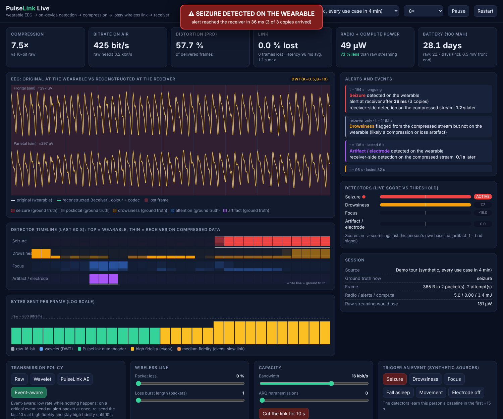
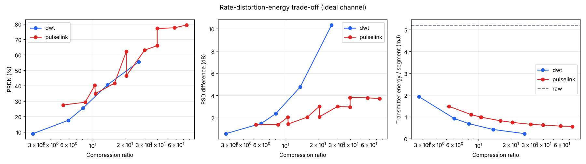
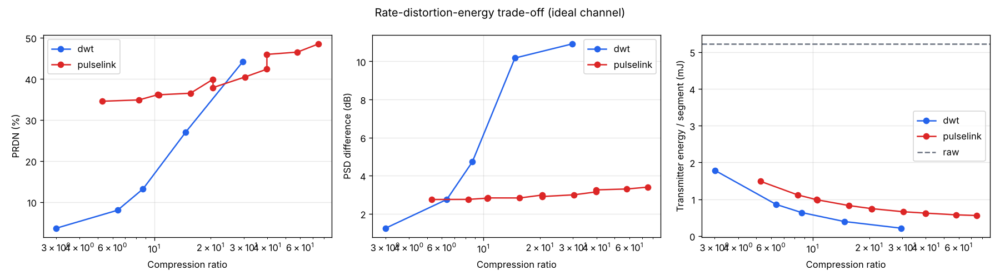

# PulseLink

**The fastest reliable alert from a wearable EEG, even on a bad link.**

When something happens in the brain (a seizure, a driver nodding off, an electrode
falling off), someone else needs to know within seconds. PulseLink is the layer
between an EEG sensor (OpenBCI, Muse, a clinical headband...) and the person who
has to react. It detects events **on the wearable**, sends the decision first
over a **priority link**, keeps compressed EEG flowing in the background, and
makes sure the alert arrives even when the link is slow, lossy or down.

```
EEG sensor ──► WEARABLE ─────────────────────────────────────────────► LINK ─────────────► PHONE / CAREGIVER
               causal filter, shared features every 0.5 s             P0 critical alert   notification centre
               ├─ early stage (2 s window): "possible seizure" ──P1──►  (ACK, 2 spaced     (acknowledge, escalate,
               ├─ detector (4 s window): "seizure confirmed" ───P0──►   copies, backup     optional phone push)
               ├─ heartbeat when the queue is busy ─────────────P1──►   radio, preempts    "monitoring offline"
               └─ compression: low rate normally (P3),                  data packets)      watchdog
                  high fidelity + last 10 s around events (P2) ─────►  P2/P3 EEG, stale    decoded EEG, receiver-
                                                                       P3 dropped          side detectors
```

What makes it different from "stream the EEG and let the phone decide":

| | Typical wearable | PulseLink |
|---|---|---|
| Where the decision is made | on the phone, after the EEG has crossed the link | on the wearable, on the clean signal |
| First warning | after the full detector window (~4 s) plus queueing | **two-stage**: "possible event" after ~1.5 s, confirmed after ~4 s |
| Slow or congested link | alert waits behind EEG; can take minutes or never arrive | alerts jump the queue and may interrupt a data packet |
| Packet loss | the event is missed or late | ACK + retry + two copies spaced in time |
| Link down | nothing until it comes back | backup radio after 0.5 s, local buzz after 2 s, phone shows "monitoring offline" |
| Bandwidth | one fixed codec | event-aware compression with a task-aware autoencoder |
| Use cases | one closed feature | profiles: epilepsy, driver fatigue, focus, general; plug-in detectors |

## Quick start

```bash
pip install -r requirements.txt

python main.py demo                     # PulseLink Live, opens http://localhost:8050
python run_realtime_study.py            # every result + a zip to share (~1 h on a laptop CPU)
pytest                                  # ~65 tests
```

## PulseLink Live (the demo)

```bash
python main.py demo                         # demo tour: every use case in 4 minutes
python main.py demo --profile driver        # drowsiness is the critical event
python main.py demo --host 0.0.0.0          # open it from a phone on the same Wi-Fi
PULSELINK_NTFY_TOPIC=my-secret-topic python main.py demo   # also push alerts to your phone (ntfy app)
```



The dashboard runs **two systems on the same EEG and the same link**: PulseLink, and a typical wearable
that streams compressed EEG over one queue and detects on the phone. The top of the page is a race:
how many seconds after the true onset each phone learns about the event.

How to demo it (about 3 minutes):

1. Start the tour. While the baseline is learned (~15 s), point at the EEG, the detectors and the phone panel.
2. Drag **bandwidth to 800 bit/s** and **packet loss to 20 %** with **bursts**. Watch the typical wearable's
   queue grow while PulseLink's stays small (routine EEG is compressed and stale data is dropped).
3. At t = 160 s the seizure starts: PulseLink shows *Possible seizure* after ~1.5 s and *Seizure confirmed*
   after ~4 s; the typical wearable is still seconds behind.
4. Press **Cut the link for 30 s** just before an event (or switch to the **driver** profile and cut the link
   before the drowsiness at t = 90 s): the alert goes over the **backup radio**, the phone flags
   *monitoring offline*, and the typical wearable only knows after the link returns.
5. Press **Ack** on the phone to show acknowledgement; unacknowledged critical alerts escalate after 30 s.

Sources: the demo tour, a calm synthetic stream with buttons to trigger events, downloaded CHB-MIT files
(real seizures), Sleep-EDF nights, or any EDF (`--edf file.edf --edf-channels F7-T7 F8-T8`). Trained
detectors from the study can be added with `--learned results/realtime/learned_seizure_gbm_chb01.pkl`.

## Results: what to run and send back

```bash
python run_realtime_study.py              # synthetic + CHB-MIT chb01 (downloads ~250 MB once), ~1 h
python run_realtime_study.py --patient chb03   # another CHB-MIT patient
python run_realtime_study.py --quick      # ~10-minute smoke test
python run_realtime_study.py --no-chbmit  # offline, synthetic only
python run_realtime_study.py --no-cnn     # skip the CNN on CHB-MIT (faster)
```

It writes `results/realtime/` and packs it into **`pulselink_realtime_results.zip`**: send that zip back.

| File | Question it answers |
|---|---|
| `summary.md` | every table, readable |
| `alert_speed.csv`, `figures/headline_time_to_alert*.png` | **headline**: how long until the receiver knows, PulseLink vs typical wearables, as bandwidth drops, loss rises or the link goes down (seizure; drowsiness with the driver profile) |
| `ablation.csv`, `figures/ablation.png` | what each part adds: on-device detection, priority, early warning, ACK + copies, backup radio |
| `usecase_detection.csv` | per use case: sensitivity, false alarms per hour, early-warning and detection latency, false early warnings |
| `task_compression.csv`, `figures/task_aware_compression.png` | do the detectors still work after compression? base vs task-aware autoencoder |
| `policy_cost.csv` | bitrate, PRD (overall and during seizures), radio power, battery life per policy |
| `alert_delivery.csv` | how often an alert without ACK is lost, by copies, spacing and burstiness |
| `chbmit_<patient>_*.csv` | real seizures: rule-based, logistic regression, boosted trees and tiny CNN, leave-one-file-out; when the receiver knew |
| `figures/`, `run.log` | plots, and the log for debugging |

### Headline results (synthetic study + CHB-MIT chb01, 20 min run)

Median seconds from true seizure onset until the phone knows (11 events per condition):

| Link condition | PulseLink first warning | PulseLink confirmed | Typical wearable (DWT stream) | Raw stream |
|---|---|---|---|---|
| 16 kbit/s, clean | **1.5 s** | 4.0 s | 4.1 s | 6.5 s |
| 800 bit/s | **1.7 s** | | 5.2 s | never (91 % missed) |
| 40 % bursty loss | **1.7 s** | | 8.1 s (p90 22 s) | never |
| 30 s outage at onset | **2.4 s** (backup radio) | 4.9 s | 28.5 s | |

- Driver profile (drowsiness is critical): 1.5 to 1.9 s vs 6 to 19 s; 2.4 s vs 28.4 s during an outage.
- Ablation (1.6 kbit/s, 20 % bursty loss): on-device detection in one FIFO queue still misses 18 % of
  alerts; priority + ACK + copies bring that to 0, and the early stage cuts the median from ~4.1 s to 1.6 s.
  Only the backup radio helps when the link is down (28.3 s to 2.4 s).
- Task-aware autoencoder: the receiver's drowsiness and attention detectors keep sensitivity 1.0 after
  compression (base autoencoder: 0.57 and 0.17), at compression ratio 11.3. The event policy keeps PRD
  during seizures at 4.2 % and still saves 71 % radio energy.
- CHB-MIT chb01 (real seizures, leave-one-file-out): all four detectors find 4/4 seizures. False alarms per
  hour: rule-based 4.8, logistic regression 2.2, boosted trees 1.0, tiny CNN 1.5. With the rule-based detector
  the phone knows after a median 1.3 s, vs 8.1 s for the typical-wearable baseline.

Caveats: link conditions and most events are simulated; CHB-MIT here is one patient; the rule-based early
stage raises ~4.5 false early warnings per hour (they are P1 "possible" notices and are cancelled if not
confirmed). Figures: [`headline_time_to_alert.png`](results/realtime/figures/headline_time_to_alert.png),
[`ablation.png`](results/realtime/figures/ablation.png),
[`task_aware_compression.png`](results/realtime/figures/task_aware_compression.png) (after running the study).

Background reading on real-time EEG wearables, transmission and detection:
[`docs/realtime_eeg_research.md`](docs/realtime_eeg_research.md).

## How it works

**Two-stage detection.** Every detector turns the shared window features into a score against the
wearer's own running baseline (median / MAD), with hysteresis. Critical detectors also get a fast
early stage: the same score on a 2 s window every 0.5 s, with its own baseline. Two hits in a row raise
*possible event* (P1); the full detector confirms (P0) or the warning is cancelled after 8 s.

**Priority link** (`communication/priority_link.py`). A discrete-event simulation of a BLE-like link
(bandwidth, bursty loss in time, outages, MTU 244 B). Five strict-priority classes; P0/P1 can interrupt a
lower-class packet in flight, have end-to-end ACK and retry, and P0 alerts are sent as two copies 0.1 s
apart. Routine EEG older than 20 s is dropped instead of being delivered uselessly late. If a P0 alert is
not ACKed within 0.5 s (or the link is down), it goes over a backup radio (LTE-M / NB-IoT / LoRa class:
slow, ~0.8 s, ~20 mJ per message, independent of the BLE link). `priority=False` turns it into the single
FIFO queue of a typical streaming wearable.

**Compression.** Routine EEG uses the PulseLink autoencoder, fine-tuned on 2 s frames with a task loss
that protects band powers, line length and the ratios the detectors use (`compression/train_streaming.py`,
saved as `models/pulselink_ae_stream.pt`). Around a critical event the wearable switches to high fidelity,
re-sends the last 10 s (pre-trigger buffer) and picks the best codec that fits the link.

**Receiver.** Decodes frames as they arrive, conceals lost ones, runs the same detectors on the
reconstruction (this is the "typical wearable" path), keeps the notification centre and raises
*monitoring offline* when nothing has arrived for 6 s: silence is never shown as "all clear".

**ML.** Shared features (band powers, line length, rhythmicity, Hjorth mobility and complexity,
spectral entropy, asymmetry, flat line). Detectors: rule-based with personal baselines, `LearnedDetector`
(logistic regression or gradient-boosted trees on the features) and `CNNDetector` (tiny 1-D CNN on the
raw window, ~18 k weights). On CHB-MIT all are trained patient-specific, leave-one-file-out.

### Adding a new use case

```python
from realtime.detectors import Detector, register

@register
class BlinkDetector(Detector):          # any rule on the shared features
    name, title, window_s, threshold = "blink", "Eye blink", 2.0, 3.0
    def baseline_values(self, f):        # tracked per person (median / MAD)
        return {"delta": np.log(f.band["delta"])}
    def raw_score(self, f, z):
        return z["delta"]
```

then add a profile in `realtime/profiles.py` that says how urgent it is (`{"blink": 1}` = P1 warning,
`0` = critical with early warning and backup radio). Or train one from labelled windows:
`LearnedDetector(name="drowsy", kind="gbm").fit(features, labels)` or `CNNDetector(...).fit(windows, labels)`.

## The offline compression pipeline

PulseLink started as an energy-aware EEG compression study, and that pipeline is still here and
unchanged: it compresses 30 s Sleep-EDF segments with a DWT baseline and a frequency-aware autoencoder,
sends them over a simulated link, reconstructs them, flags unreliable segments and measures energy.

```bash
python main.py run --quick            # whole offline pipeline + experiments (~1.5 min)
python main.py run --download --retrain              # fetch Sleep-EDF subjects 0-3, night 1 (~200 MB) and train
python main.py run --download --retrain --nights 1 2 # both nights per subject (~390 MB), as in the results below
python main.py run --real                            # later runs: use the downloaded files, fail if missing
streamlit run dashboard/app.py        # offline interactive demo
python main.py train --retrain --epochs 40
python main.py stream --method adaptive --bandwidth 1600 --loss 0.05 --retries 2
```

`--download` tries physionet.org first and falls back to PhysioNet's AWS Open Data mirror when
physionet.org is blocked. `main.py run` writes CSVs, `summary.md` and figures to `results/`.

## Repository layout

| Path | What it does |
|---|---|
| `config.py` | Every tunable number: filter band, segment length, model size, channel, **energy assumptions**, quality thresholds |
| `preprocessing/load_eeg.py` | Sleep-EDF loading with MNE (channels `EEG Fpz-Cz`, `EEG Pz-Oz`, hypnogram labels, wake cropping) and synthetic fallback |
| `preprocessing/synthetic.py` | Synthetic sleep EEG: stage-dependent rhythms, spindles, K-complexes, 1/f background, artifacts |
| `preprocessing/filtering.py`, `segmentation.py` | Zero-phase Butterworth band-pass; windowing; per-segment normalisation |
| `compression/wavelet_compression.py` | DWT baseline: db4, 5 levels, keep top-k coefficients, quantise, significance map |
| `compression/autoencoder.py` | 1D conv autoencoder, frequency-aware loss, straight-through quantisation, MAC counting |
| `compression/train.py` | Training loop |
| `compression/quantization.py` | Quantisers, bit packing and the self-describing segment bitstream |
| `compression/codecs.py` | Common codec interface (raw / DWT / PulseLink) with op counts for the energy model |
| `compression/adaptive.py` | Rule-based adaptive controller, distortion predictor, event detection |
| `communication/channel_simulator.py` | Discrete-event link: packetisation, bandwidth, buffer, outages, ARQ, latency |
| `communication/packet_loss.py` | Bernoulli and Gilbert–Elliott (bursty) loss, outage schedules |
| `reconstruction/decoder.py` | Receiver: reassembly, decoding, concealment, partial recovery of raw packets |
| `reconstruction/quality_check.py` | Artifact detection (transmitter) and reliability flags (receiver) |
| `evaluation/signal_metrics.py` | CR, PRD/PRDN, RMSE, SNR, PSD difference, band-power errors |
| `evaluation/energy_model.py` | `E_net = E_transmission + E_compression + E_reconstruction` |
| `evaluation/classification.py` | Sleep-stage classifier (band-power features + random forest) |
| `evaluation/comparison.py` | Codec benchmark, packet-loss / bandwidth / outage experiments, plots |
| `pipeline.py` | Glue: data → model → transmitter → channel → receiver → metrics |
| `dashboard/app.py` | Streamlit demo (offline pipeline) |
| `realtime/features.py` | Shared per-window features (band powers, line length, rhythmicity, Hjorth, spectral entropy, flat line, ...) |
| `realtime/detectors.py` | Pluggable detectors with personal baselines, hysteresis and a fast early stage; `LearnedDetector` (logistic regression / boosted trees) and `CNNDetector` (tiny 1-D CNN) |
| `realtime/profiles.py` | Use-case profiles (epilepsy, driver, focus, general): which detector is critical, priority of each |
| `realtime/sources.py` | Live synthetic EEG with injectable events, recording replay, CHB-MIT download and loading, any EDF |
| `realtime/engine.py` | Wearable → priority link → receiver engine: two-stage detection, alerts, heartbeat, offline watchdog, event-aware compression, presets for comparisons |
| `realtime/notify.py` | Receiver notification centre: acknowledge, escalate, optional phone push |
| `communication/priority_link.py` | P0-P4 priority link: preemption, ACK + retry, spaced copies, stale-data deadlines, backup radio, FIFO mode |
| `compression/train_streaming.py` | Task-aware fine-tune of the autoencoder on 2 s frames (`models/pulselink_ae_stream.pt`) |
| `realtime/server.py`, `realtime/static/index.html` | PulseLink Live web dashboard (`python main.py demo`) |
| `realtime/experiments.py` | Real-time experiments and figures (`python main.py realtime`) |
| `run_realtime_study.py` | One command that runs the real-time study and zips the results |
| `models/pulselink_ae_stream.pt` | Task-aware streaming autoencoder used by the real-time system (fine-tuned from the model below) |
| `models/pulselink_ae.pt` | Autoencoder trained on Sleep-EDF subjects 0-2 (6 nights, 60 epochs); subject 3 is held out |
| `docs/sample_results_sleep_edf.md` | Output of `python main.py run --real --retrain --nights 1 2` |
| `docs/sample_results_synthetic.md` | Output of `python main.py run --synthetic` |

## Design of the offline compression pipeline

### Preprocessing
Sleep-EDF EEG is sampled at 100 Hz. Two channels (Fpz-Cz, Pz-Oz) are band-passed
0.5–40 Hz (4th-order zero-phase Butterworth; the top edge is clipped below
Nyquist), cut into 30 s windows that line up with the hypnogram epochs, so each
segment is `X ∈ R^{2×3000}`. Each segment is z-scored per channel; the mean and
standard deviation travel in the segment header (float16) so the receiver
restores microvolts. Long wake periods before and after sleep are cropped to
30 min, as is standard for Sleep-EDF.

### Baseline: DWT
`pywt.wavedec` (db4, 5 levels) per channel, keep the largest `k` fraction of
coefficients over all channels, quantise them with a symmetric `b`-bit
quantiser, send a significance bitmap plus packed codes (zlib if it helps).

### PulseLink autoencoder
Asymmetric 1D convolutional autoencoder. The encoder runs on the wearable, so
it is small (four strided convolutions, **~4.8 M MACs per 30 s segment**); the
decoder runs on the receiver and is larger (~68 M MACs).

| | Shape |
|---|---|
| Input `X` | `(2, 3000)` → reflect-padded to `(2, 3008)` |
| Encoder | Conv1d stride 2: 2→16→32→32→16, kernel 5, GELU |
| Latent `Z` | `(16, 188)`, `tanh` so values lie in `[-1, 1]` |
| Decoder | (linear upsample ×2 + 2 convs) × 4: 16→64→64→32→2 |
| Output `X̂` | `(2, 3000)` |

**Real compression, not just smaller tensors:** the latent is quantised to `b`
bits (uniform over the fixed `tanh` range, so no side information), bit-packed
and written into the bitstream. All reported sizes are `len()` of the bytes
that go into packets.

**One model, many rates.** Training uses straight-through rounding at a random
bit depth (3–8) and *nested dropout* on latent channels (only the first `k` of
16 are kept), so channels are ordered by importance. At run time the
transmitter can send any prefix `k ∈ {2, 4, 8, 16}` at any `b`, which gives the
adaptive controller a ladder of rates without retraining.

**Frequency-aware loss**

```
L = α · ||X − X̂||²  +  β · || log PSD(X) − log PSD(X̂) ||₁      (α = 1, β = 0.5)
```

The PSD is a Hann-windowed periodogram averaged into 0.5 Hz bins inside
0.5–40 Hz. Bin averaging matters: raw periodograms of noise-like signals
fluctuate so much that two signals with the same spectrum still look
different. Log power stops delta from drowning out alpha, sigma and beta.

### Bitstream
Each segment is a self-describing byte string: magic, version, codec id,
flags (important event / poor input quality / zlib), channel count, length,
the encoder's PRD estimate, per-channel mean/std, payload. See
`compression/quantization.py`.

### Channel simulator
Segments are split into ≤244-byte payloads (BLE 5 ATT size) plus an 8-byte
header and queued FIFO. Packets are serialised at the current bandwidth
(optionally a time-varying schedule), lost with a Bernoulli or Gilbert–Elliott
(bursty) model, delayed by latency + jitter, and held in the transmit buffer
during outages and flushed after reconnection. A full buffer drops new
packets. Optional stop-and-wait ARQ retransmits lost packets (each attempt
costs energy).

### Receiver and reliability flags
A compressed segment is decodable only if all its packets arrive; otherwise it
is concealed (zeros, or repeat-last) and flagged `lost`. Raw segments degrade
gracefully: received samples are kept and gaps are interpolated (flagged
`concealed_gaps`), which keeps the comparison fair. The receiver never sees
the original, so it flags from evidence it has: lost or concealed data,
late arrival, the encoder's PRD estimate in the header (`high_distortion`),
the transmitter's poor-input flag, and plausibility checks (non-finite
values, flat output, power outside 0.5–40 Hz). Experiments report how well
these flags match the true distortion (`flag_recall`, `flag_precision`).

### Adaptive compression (rule-based)
The ladder of modes (raw, DWT at several `k`, PulseLink at several `k`/`b`) is
calibrated on held-out data. Each mode gets an expected size, expected
transmitter energy and a small ridge-regression **distortion predictor** that
estimates the PRD a particular segment would suffer, from cheap spectral
features (one FFT, ~0.1 M ops). Modes that are larger *and* worse than another
mode are pruned automatically, so a poorly trained autoencoder is simply not
used.

| Condition | Behaviour |
|---|---|
| Default | Lowest-energy mode whose predicted PRD meets the target (15 %) |
| Good connectivity | Link could nearly carry raw → stricter target (10 %), i.e. lower compression |
| Limited bandwidth | Budget = bandwidth × 30 s × utilisation − backlog → larger modes excluded, higher compression |
| Lossy link | Expected PRD counts an undecodable segment as 100 %, so fewer packets are preferred |
| Outage / backlog | Budget shrinks so the buffer drains after reconnection |
| Poor signal quality | Learned modes excluded (the autoencoder was trained on clean EEG); DWT/raw used; segment flagged |
| Important event (spindles, K-complexes) | Stricter target (8 %) and up to 2× budget; segment flagged |

The predicted PRD goes into the header, which is what lets the receiver flag
`high_distortion` without the original.

### Energy model
```
E_net = E_transmission + E_compression + E_reconstruction
E_transmission = bits_on_air · E_bit + packet_attempts · E_packet
E_compression  = encoder ops · E_op(MCU)
```
Defaults in `config.EnergyConfig`: 50 nJ/bit radio, 5 µJ per packet,
0.1 nJ per MCU MAC (int8 SIMD, Cortex-M4 class). Headers and retransmissions
are paid for, and op counts come from the actual model (convolution MACs
counted with forward hooks) and from the DWT filter lengths. The receiver's
energy is reported separately. **These are assumptions for a transparent
model, not measurements.** Swap in datasheet or measured values for your
hardware.

## Results on Sleep-EDF

From `python main.py run --real --retrain --nights 1 2`: Sleep Cassette subjects
0-3, both nights (8154 segments of 30 s, `Fpz-Cz` + `Pz-Oz` at 100 Hz). The
autoencoder and stager are trained on subjects 0-2; **subject 3 is held out
entirely** and the first 120 test segments are streamed. Full tables:
[`docs/sample_results_sleep_edf.md`](docs/sample_results_sleep_edf.md).
The stager scores 0.892 accuracy (kappa 0.82) on the original test EEG.



| Method | CR | PRDN % | PSD diff dB | Band-power err | Stage acc | Tx energy mJ/seg | Saving vs raw |
|---|---|---|---|---|---|---|---|
| Raw | 1.0 | 0.0 | 0.0 | 0.00 | 0.892 | 5.22 | 0 % |
| DWT k=0.05 | 26.8 | 55.4 | 10.3 | 0.57 | 0.758 | 0.23 | 96 % |
| PulseLink k=8, b=3 | 20.6 | 46.4 | 2.1 | 0.18 | 0.817 | 0.74 | 86 % |
| DWT k=0.1 | 13.7 | 40.4 | 4.8 | 0.36 | 0.825 | 0.42 | 92 % |
| PulseLink k=8, b=4 | 16.0 | 41.6 | 2.1 | 0.18 | 0.850 | 0.82 | 84 % |
| DWT k=0.2 | 8.1 | 25.4 | 2.4 | 0.17 | 0.867 | 0.69 | 87 % |
| PulseLink k=16, b=4 | 8.5 | 29.3 | 1.4 | 0.09 | 0.900 | 1.10 | 79 % |
| Adaptive (64 kbit/s) | 1.7 | 4.4 | 0.6 | 0.03 | 0.875 | 3.18 | 39 % |

What real EEG changes compared with the synthetic run:

* **Spectra: the learned codec still wins, by less.** At similar ratios
  PulseLink's PSD error is 2-5x lower than DWT's and band-power error about
  half. Its sleep-stage accuracy is higher at every matched ratio (0.85 vs
  0.825 at ~15x, 0.90 vs 0.867 at ~8x).
* **Waveform PRD: DWT is as good or better up to ~15x.** At ~8x DWT reaches
  25 % PRDN against 29 % for PulseLink. Real EEG is harder to compress than
  the synthetic signal: no setting of either codec reaches the 10-15 % PRD
  targets above ~6x.
* **Adaptive therefore compresses much less on a good link** (1.7x, 39 % energy
  saving, against 4.6x and 77 % on synthetic data), because its strict 10 %
  target leaves only high-rate DWT and raw. On constrained links it behaves as
  designed: 5.3x and 18 % PRDN at 800 bit/s, where raw overflows its buffer
  and ends at 73 % PRDN with 0.40 stage accuracy.
* **Compute dominates PulseLink's energy.** The encoder's ~4.9 M ops cost
  ~0.48 mJ per segment under the model's assumptions, so at the same size
  DWT uses about half the transmitter energy.
* **Packet loss without ARQ** behaves as on synthetic data: every compressed
  method loses whole segments, and the receiver's reliability flags catch only
  14-38 % of the damaged DWT/PulseLink segments (adaptive: ~96 %, because it
  writes its predicted PRD into the header). With 2 ARQ retries no segment is
  lost up to 10 % loss.
* **Longer training helps.** Going from 30 to 60 epochs lowered PRDN at full
  latent width from 34 % to 29 % and raised stage accuracy from 0.867 to
  0.900; validation loss was still falling at 30 epochs.

## Results on synthetic data

From `python main.py run --synthetic` with 120 held-out 30 s segments
(full tables: [`docs/sample_results_synthetic.md`](docs/sample_results_synthetic.md)).
Synthetic data shows the pipeline works; **it is not evidence about real
EEG.** Rerun on Sleep-EDF before drawing conclusions.



| Method | CR | PRDN % | PSD diff dB | Band-power err | Stage acc | Tx energy mJ/seg | Saving vs raw |
|---|---|---|---|---|---|---|---|
| Raw | 1.0 | 0.0 | 0.0 | 0.00 | 0.99 | 5.22 | 0 % |
| DWT k=0.05 | 29.6 | 44.2 | 10.9 | 5.13 | 0.94 | 0.21 | 96 % |
| PulseLink k=4, b=4 | 30.4 | 40.4 | 3.0 | 0.57 | 0.95 | 0.66 | 87 % |
| DWT k=0.1 | 14.7 | 27.0 | 10.2 | 2.67 | 0.94 | 0.39 | 92 % |
| PulseLink k=8, b=4 | 15.6 | 36.5 | 2.8 | 0.56 | 0.95 | 0.83 | 84 % |
| Adaptive (64 kbit/s) | 4.6 | 6.4 | – | – | 0.98 | 1.21 | 77 % |

What this run shows:

* **Frequency preservation is where the learned codec wins.** At the same
  compression ratio, PulseLink keeps the spectrum 3–4× closer (PSD difference
  ~3 dB against ~10 dB) and band powers ~5–10× more accurately than DWT.
  DWT has lower waveform PRD at moderate ratios, because hard thresholding
  keeps the large coefficients exactly but throws away the low-power bands.
* **At very high ratios (30–75×)** PulseLink keeps both PRD and spectra
  usable while DWT's spectra fall apart.
* **Compute is not free.** The autoencoder encoder costs ~0.48 mJ per segment
  under these assumptions, ~14× more than DWT. DWT therefore uses less
  transmitter energy at the same size, and the controller weighs this per
  segment.
* **Adaptive** gets 6 % PRDN with 77 % less transmitter energy than raw on a
  good link. It drops to ~9.5 % PRDN on an 800 bit/s link, where raw
  streaming overflows its buffer (68 % PRDN once losses are counted).
* **Packet loss without ARQ** hits large segments hardest: a compressed
  segment needs every packet. With 2 ARQ retries, every compressed method
  delivers every segment up to 10 % loss for a few percent more energy.
* **Buffering**: during a 15 min disconnection with a 256 kB buffer, adaptive
  loses no segments, while raw overflows the buffer and loses 10.

## Limitations and next steps

* The Sleep-EDF results use 4 subjects with one held out and 120 test
  segments (one hour). A rigorous study needs more subjects (the Sleep
  Cassette set has 78) and leave-one-subject-out cross-validation.
* On real EEG the quality targets (15 % / 10 % / 8 % PRD) are stricter than
  any lossy mode reaches at useful ratios; a band-power or stage-accuracy
  target may suit the adaptive controller better than PRD.
* The energy model is analytical. A BLE prototype (e.g. nRF52) with a power
  analyser would replace the assumptions with measurements.
* The ladder's thresholds (15 % / 10 % / 8 % PRD) are design choices; sweep
  them and report the trade-off curves.
* Possible extensions: forward error correction for lossy links without ARQ,
  int8-quantised encoder weights, entropy coding of the latent with a learned
  prior, and the CHB-MIT dataset (seizure preservation).

## Team split (from the roadmap)

* **Signal processing & dataset**: `preprocessing/`, `compression/wavelet_compression.py`, `evaluation/signal_metrics.py`
* **ML model**: `compression/autoencoder.py`, `compression/train.py`, `reconstruction/quality_check.py`
* **Communication & integration**: `compression/quantization.py`, `communication/`, `evaluation/energy_model.py`, `dashboard/`, `main.py`
