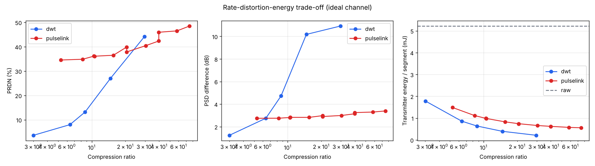

# PulseLink

**Energy-aware, frequency-preserving EEG compression and reconstruction.**

PulseLink compresses multichannel EEG on a (simulated) wearable transmitter,
sends it over a constrained wireless link with packet loss, limited bandwidth
and disconnections, reconstructs it at the receiver, flags segments that
should not be trusted, and measures how much transmitter energy is saved
compared with streaming raw samples.

```
Sleep-EDF / synthetic EEG
   │  preprocessing/   band-pass 0.5–40 Hz, 30 s segments, per-segment z-score
   ▼
Transmitter
   │  compression/     raw | DWT baseline | 1D conv autoencoder (frequency-aware loss)
   │                   quantisation + real bitstream  ·  adaptive, energy-aware controller
   ▼
Channel             communication/  bandwidth, Bernoulli/bursty loss, jitter, outages,
   │                                transmit buffer, optional ARQ
   ▼
Receiver            reconstruction/ reassembly, decoding, loss concealment,
   │                                reliability flags (without the original)
   ▼
Evaluation          evaluation/     PRD/RMSE/SNR, PSD and band-power error, sleep-stage
                                    accuracy, energy model, experiments  ·  dashboard/
```

Everything runs on a laptop CPU. If Sleep-EDF is not downloaded, PulseLink
falls back to **synthetic sleep EEG** so every script, test and the dashboard
still work.

## Quick start

```bash
pip install -r requirements.txt

python main.py run --quick            # whole pipeline + experiments (~1.5 min on a laptop CPU)
streamlit run dashboard/app.py        # interactive demo
pytest                                # 39 tests, ~10 s
```

With real data:

```bash
python main.py run --download --retrain   # fetch Sleep-EDF subjects 0-3 (~200 MB) and train on them
python main.py run --real                 # later runs: use the downloaded files, fail if missing
```

Other commands:

```bash
python main.py train --retrain --epochs 40                 # train only (writes models/pulselink_ae.pt)
python main.py stream --method adaptive --bandwidth 1600 --loss 0.05 --retries 2
python main.py stream --method raw --outage 300 120        # 120 s disconnection at t = 300 s
```

`main.py run` writes CSVs, `summary.md` and figures to `results/`.
Training on Colab: open a notebook, `!git clone` the repo, `!pip install -r requirements.txt`,
then `!python main.py train --download --retrain --epochs 60` (uses the GPU automatically).

## Repository layout

| Path | What it does |
|---|---|
| `config.py` | Every tunable number: filter band, segment length, model size, channel, **energy assumptions**, quality thresholds |
| `preprocessing/load_eeg.py` | Sleep-EDF loading with MNE (channels `EEG Fpz-Cz`, `EEG Pz-Oz`, hypnogram labels, wake cropping) and synthetic fallback |
| `preprocessing/synthetic.py` | Synthetic sleep EEG: stage-dependent rhythms, spindles, K-complexes, 1/f background, artifacts |
| `preprocessing/filtering.py`, `segmentation.py` | Zero-phase Butterworth band-pass; windowing; per-segment normalisation |
| `compression/wavelet_compression.py` | DWT baseline: db4, 5 levels, keep top-k coefficients, quantise, significance map |
| `compression/autoencoder.py` | 1D conv autoencoder, frequency-aware loss, straight-through quantisation, MAC counting |
| `compression/train.py` | Training loop |
| `compression/quantization.py` | Quantisers, bit packing and the self-describing segment bitstream |
| `compression/codecs.py` | Common codec interface (raw / DWT / PulseLink) with op counts for the energy model |
| `compression/adaptive.py` | Rule-based adaptive controller, distortion predictor, event detection |
| `communication/channel_simulator.py` | Discrete-event link: packetisation, bandwidth, buffer, outages, ARQ, latency |
| `communication/packet_loss.py` | Bernoulli and Gilbert–Elliott (bursty) loss, outage schedules |
| `reconstruction/decoder.py` | Receiver: reassembly, decoding, concealment, partial recovery of raw packets |
| `reconstruction/quality_check.py` | Artifact detection (transmitter) and reliability flags (receiver) |
| `evaluation/signal_metrics.py` | CR, PRD/PRDN, RMSE, SNR, PSD difference, band-power errors |
| `evaluation/energy_model.py` | `E_net = E_transmission + E_compression + E_reconstruction` |
| `evaluation/classification.py` | Sleep-stage classifier (band-power features + random forest) |
| `evaluation/comparison.py` | Codec benchmark, packet-loss / bandwidth / outage experiments, plots |
| `pipeline.py` | Glue: data → model → transmitter → channel → receiver → metrics |
| `dashboard/app.py` | Streamlit demo |
| `models/pulselink_ae.pt` | Autoencoder trained on synthetic EEG (retrain on Sleep-EDF for real results) |
| `docs/sample_results_synthetic.md` | Output of `python main.py run --synthetic` |

## Design

### Preprocessing
Sleep-EDF EEG is sampled at 100 Hz. Two channels (Fpz-Cz, Pz-Oz) are band-passed
0.5–40 Hz (4th-order zero-phase Butterworth; the top edge is clipped below
Nyquist), cut into 30 s windows that line up with the hypnogram epochs, so each
segment is `X ∈ R^{2×3000}`. Each segment is z-scored per channel; the mean and
standard deviation travel in the segment header (float16) so the receiver
restores microvolts. Long wake periods before and after sleep are cropped to
30 min, as is standard for Sleep-EDF.

### Baseline: DWT
`pywt.wavedec` (db4, 5 levels) per channel, keep the largest `k` fraction of
coefficients over all channels, quantise them with a symmetric `b`-bit
quantiser, send a significance bitmap plus packed codes (zlib if it helps).

### PulseLink autoencoder
Asymmetric 1D convolutional autoencoder. The encoder runs on the wearable, so
it is small (four strided convolutions, **~4.8 M MACs per 30 s segment**); the
decoder runs on the receiver and is larger (~68 M MACs).

| | Shape |
|---|---|
| Input `X` | `(2, 3000)` → reflect-padded to `(2, 3008)` |
| Encoder | Conv1d stride 2: 2→16→32→32→16, kernel 5, GELU |
| Latent `Z` | `(16, 188)`, `tanh` so values lie in `[-1, 1]` |
| Decoder | (linear upsample ×2 + 2 convs) × 4: 16→64→64→32→2 |
| Output `X̂` | `(2, 3000)` |

**Real compression, not just smaller tensors:** the latent is quantised to `b`
bits (uniform over the fixed `tanh` range, so no side information), bit-packed
and written into the bitstream. All reported sizes are `len()` of the bytes
that go into packets.

**One model, many rates.** Training uses straight-through rounding at a random
bit depth (3–8) and *nested dropout* on latent channels (only the first `k` of
16 are kept), so channels are ordered by importance. At run time the
transmitter can send any prefix `k ∈ {2, 4, 8, 16}` at any `b`, which gives the
adaptive controller a ladder of rates without retraining.

**Frequency-aware loss**

```
L = α · ||X − X̂||²  +  β · || log PSD(X) − log PSD(X̂) ||₁      (α = 1, β = 0.5)
```

The PSD is a Hann-windowed periodogram averaged into 0.5 Hz bins inside
0.5–40 Hz. Bin averaging matters: raw periodograms of noise-like signals
fluctuate so much that two signals with the same spectrum still look
different. Log power stops delta from drowning out alpha, sigma and beta.

### Bitstream
Each segment is a self-describing byte string: magic, version, codec id,
flags (important event / poor input quality / zlib), channel count, length,
the encoder's PRD estimate, per-channel mean/std, payload. See
`compression/quantization.py`.

### Channel simulator
Segments are split into ≤244-byte payloads (BLE 5 ATT size) plus an 8-byte
header and queued FIFO. Packets are serialised at the current bandwidth
(optionally a time-varying schedule), lost with a Bernoulli or Gilbert–Elliott
(bursty) model, delayed by latency + jitter, and held in the transmit buffer
during outages and flushed after reconnection. A full buffer drops new
packets. Optional stop-and-wait ARQ retransmits lost packets (each attempt
costs energy).

### Receiver and reliability flags
A compressed segment is decodable only if all its packets arrive; otherwise it
is concealed (zeros, or repeat-last) and flagged `lost`. Raw segments degrade
gracefully: received samples are kept and gaps are interpolated (flagged
`concealed_gaps`), which keeps the comparison fair. The receiver never sees
the original, so it flags from evidence it has: lost or concealed data,
late arrival, the encoder's PRD estimate in the header (`high_distortion`),
the transmitter's poor-input flag, and plausibility checks (non-finite
values, flat output, power outside 0.5–40 Hz). Experiments report how well
these flags match the true distortion (`flag_recall`, `flag_precision`).

### Adaptive compression (rule-based)
The ladder of modes (raw, DWT at several `k`, PulseLink at several `k`/`b`) is
calibrated on held-out data. Each mode gets an expected size, expected
transmitter energy and a small ridge-regression **distortion predictor** that
estimates the PRD a particular segment would suffer, from cheap spectral
features (one FFT, ~0.1 M ops). Modes that are larger *and* worse than another
mode are pruned automatically, so a poorly trained autoencoder is simply not
used.

| Condition | Behaviour |
|---|---|
| Default | Lowest-energy mode whose predicted PRD meets the target (15 %) |
| Good connectivity | Link could nearly carry raw → stricter target (10 %), i.e. lower compression |
| Limited bandwidth | Budget = bandwidth × 30 s × utilisation − backlog → larger modes excluded, higher compression |
| Lossy link | Expected PRD counts an undecodable segment as 100 %, so fewer packets are preferred |
| Outage / backlog | Budget shrinks so the buffer drains after reconnection |
| Poor signal quality | Learned modes excluded (the autoencoder was trained on clean EEG); DWT/raw used; segment flagged |
| Important event (spindles, K-complexes) | Stricter target (8 %) and up to 2× budget; segment flagged |

The predicted PRD goes into the header, which is what lets the receiver flag
`high_distortion` without the original.

### Energy model
```
E_net = E_transmission + E_compression + E_reconstruction
E_transmission = bits_on_air · E_bit + packet_attempts · E_packet
E_compression  = encoder ops · E_op(MCU)
```
Defaults in `config.EnergyConfig`: 50 nJ/bit radio, 5 µJ per packet,
0.1 nJ per MCU MAC (int8 SIMD, Cortex-M4 class). Headers and retransmissions
are paid for, and op counts come from the actual model (convolution MACs
counted with forward hooks) and from the DWT filter lengths. The receiver's
energy is reported separately. **These are assumptions for a transparent
model, not measurements.** Swap in datasheet or measured values for your
hardware.

## Results on synthetic data

From `python main.py run --synthetic` with 120 held-out 30 s segments
(full tables: [`docs/sample_results_synthetic.md`](docs/sample_results_synthetic.md)).
Synthetic data shows the pipeline works; **it is not evidence about real
EEG.** Rerun on Sleep-EDF before drawing conclusions.



| Method | CR | PRDN % | PSD diff dB | Band-power err | Stage acc | Tx energy mJ/seg | Saving vs raw |
|---|---|---|---|---|---|---|---|
| Raw | 1.0 | 0.0 | 0.0 | 0.00 | 0.99 | 5.22 | 0 % |
| DWT k=0.05 | 29.6 | 44.2 | 10.9 | 5.13 | 0.94 | 0.21 | 96 % |
| PulseLink k=4, b=4 | 30.4 | 40.4 | 3.0 | 0.57 | 0.95 | 0.66 | 87 % |
| DWT k=0.1 | 14.7 | 27.0 | 10.2 | 2.67 | 0.94 | 0.39 | 92 % |
| PulseLink k=8, b=4 | 15.6 | 36.5 | 2.8 | 0.56 | 0.95 | 0.83 | 84 % |
| Adaptive (64 kbit/s) | 4.6 | 6.4 | – | – | 0.98 | 1.21 | 77 % |

What this run shows:

* **Frequency preservation is where the learned codec wins.** At the same
  compression ratio, PulseLink keeps the spectrum 3–4× closer (PSD difference
  ~3 dB against ~10 dB) and band powers ~5–10× more accurately than DWT.
  DWT has lower waveform PRD at moderate ratios, because hard thresholding
  keeps the large coefficients exactly but throws away the low-power bands.
* **At very high ratios (30–75×)** PulseLink keeps both PRD and spectra
  usable while DWT's spectra fall apart.
* **Compute is not free.** The autoencoder encoder costs ~0.48 mJ per segment
  under these assumptions, ~14× more than DWT. DWT therefore uses less
  transmitter energy at the same size, and the controller weighs this per
  segment.
* **Adaptive** gets 6 % PRDN with 77 % less transmitter energy than raw on a
  good link. It drops to ~9.5 % PRDN on an 800 bit/s link, where raw
  streaming overflows its buffer (68 % PRDN once losses are counted).
* **Packet loss without ARQ** hits large segments hardest: a compressed
  segment needs every packet. With 2 ARQ retries, every compressed method
  delivers every segment up to 10 % loss for a few percent more energy.
* **Buffering**: during a 15 min disconnection with a 256 kB buffer, adaptive
  loses no segments, while raw overflows the buffer and loses 10.

## Limitations and next steps

* Results above are synthetic; train and evaluate on Sleep-EDF (`--download`).
  For a rigorous study, split by subject and use more nights.
* The energy model is analytical. A BLE prototype (e.g. nRF52) with a power
  analyser would replace the assumptions with measurements.
* The ladder's thresholds (15 % / 10 % / 8 % PRD) are design choices; sweep
  them and report the trade-off curves.
* Possible extensions: forward error correction for lossy links without ARQ,
  int8-quantised encoder weights, entropy coding of the latent with a learned
  prior, and the CHB-MIT dataset (seizure preservation).

## Team split (from the roadmap)

* **Signal processing & dataset**: `preprocessing/`, `compression/wavelet_compression.py`, `evaluation/signal_metrics.py`
* **ML model**: `compression/autoencoder.py`, `compression/train.py`, `reconstruction/quality_check.py`
* **Communication & integration**: `compression/quantization.py`, `communication/`, `evaluation/energy_model.py`, `dashboard/`, `main.py`
